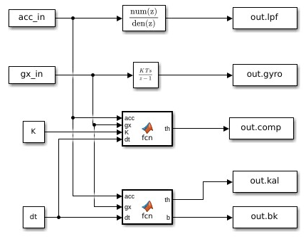
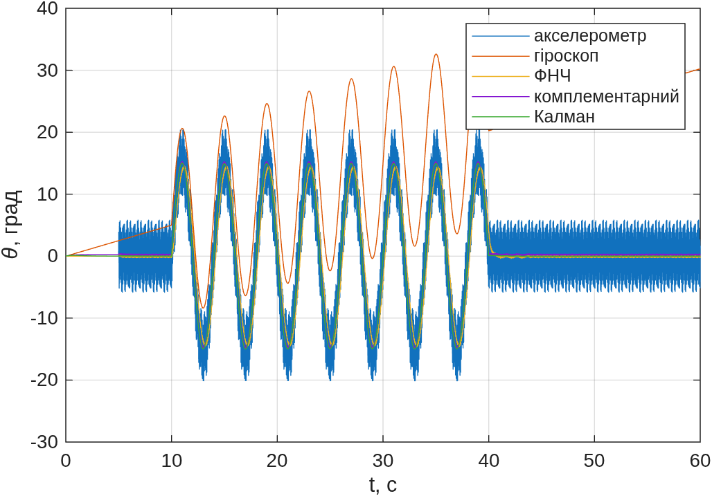
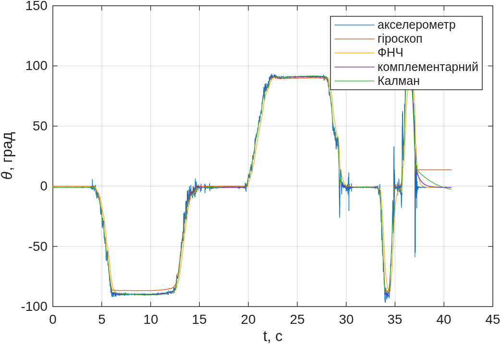
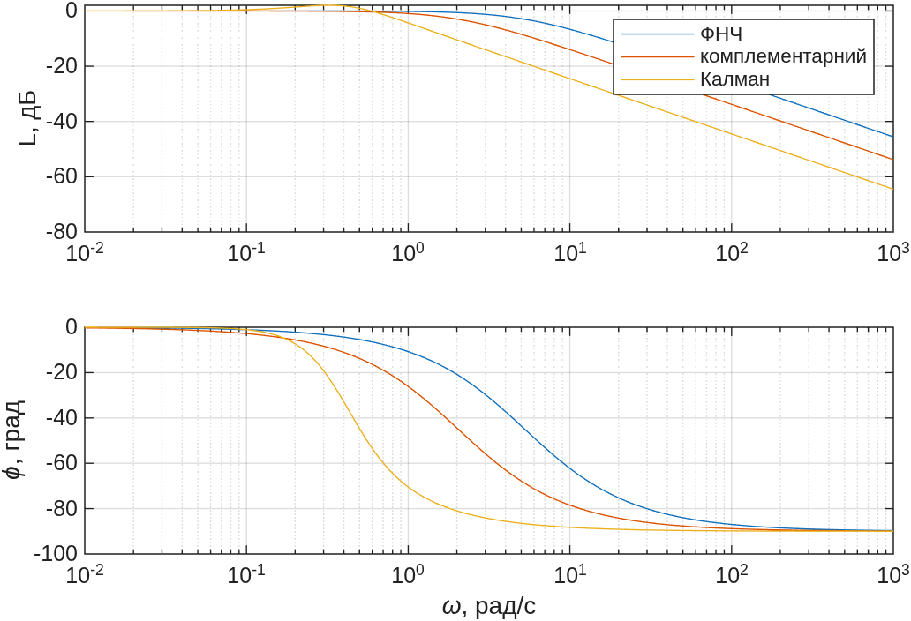
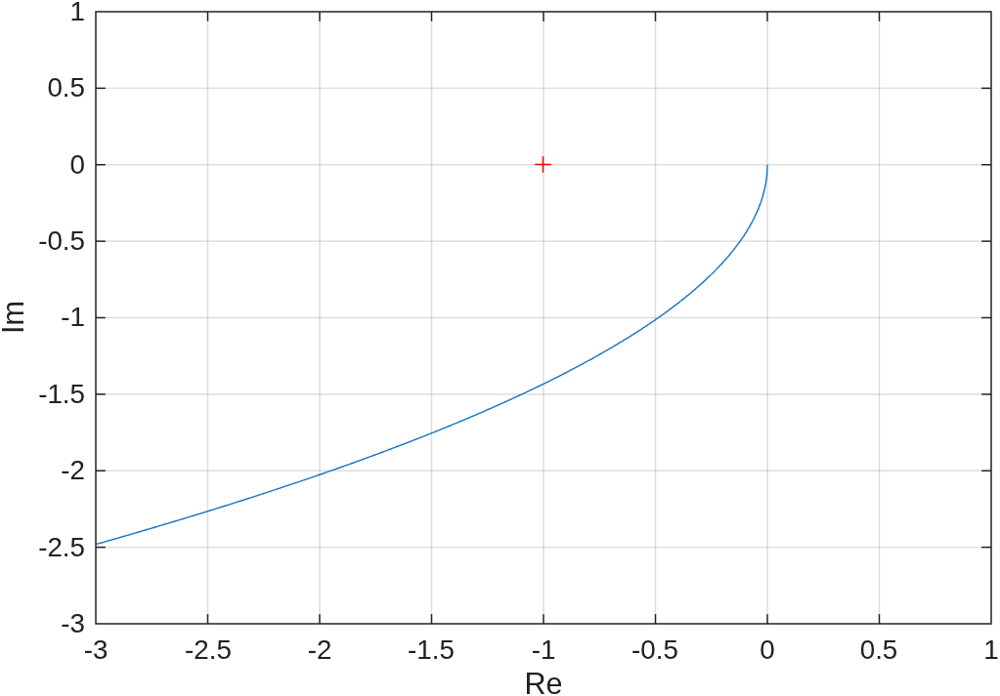

# imu-filters-mpu6050

Порівнюю три фільтри для кута крену: ФНЧ, комплементарний і фільтр Калмана.
Спочатку на моделі в MATLAB/Simulink, де справжній кут відомий, потім на реальних
записах з MPU-6050 і Arduino Uno.

## Що в репозиторії

```
imu_filters.slx      модель Simulink з усіма фільтрами
run_simulink.m       головний скрипт, проганяє дані через модель
run_matlab.m         те саме без Simulink
sweep_K.m            перебір коефіцієнта K комплементарного фільтра
filter_analysis.m    полюси, ЛАЧХ/ФЧХ і Найквіст для фільтрів

filters/             complementary_filter.m, kalman_filter.m
input/               params.m, sensor_model.m, load_mpu6050.m, load_data.m
analysis/            filter_metrics.m, tilt_analysis.m
CSV_Example/         мої записи: rest, tilt, vibration, tilt_vibration
Arduino_logger/      скетч запису сирих даних у CSV (100 Гц)
images/              картинки для README
```

| Файл | Що робить |
|---|---|
| `input/params.m` | крок dt, коефіцієнти фільтрів, поправка акселерометра |
| `input/sensor_model.m` | модель сигналів: кут + дрейф гіроскопа + вібрація |
| `input/load_mpu6050.m` | читає CSV, калібрує датчик, рахує кут з акселерометра |
| `input/load_data.m` | вибирає модель або запис |
| `filters/*.m` | самі фільтри, їх викликає Simulink |
| `analysis/filter_metrics.m` | графік і похибки |
| `analysis/tilt_analysis.m` | похибки в положеннях ±90° і запізнення |

У корені лежать тільки ті скрипти, які запускаються руками. Вони самі підключають
папки `filters`, `input` і `analysis` через `addpath`.

Місця, які можна підкручувати під свій датчик, позначені в коді коментарем `ADJUST`.

## Запуск

1. Скачати репозиторій (Code → Download ZIP) і розпакувати.
2. У MATLAB (або MATLAB Online, туди zip можна закинути через Upload і зробити `unzip`)
   зробити поточною кореневу папку репозиторію, не підпапки.
3. Відкрити `run_simulink.m` і вибрати, що фільтрувати:

```matlab
source = 'model';   % або 'rest.csv', 'tilt.csv', 'vibration.csv', 'tilt_vibration.csv'
win = [2 inf];      % для vibration.csv: [5 67]
```

4. Запустити `run_simulink`. Вийде графік і показники точності в Command Window.
   Для `tilt.csv` після цього ще можна набрати `tilt_analysis`.

Модель запускається тільки через скрипт: змінні `dt`, `alpha`, `K`, `acc_in`, `gx_in`
створює саме він. Якщо Simulink недоступний, `run_matlab` дає ті самі результати.

## Модель Simulink



Налаштування моделі: Solver `Fixed-step`, `discrete (no continuous states)`, крок `dt`.

| Блок | Що всередині |
|---|---|
| From Workspace ×2 | `acc_in` і `gx_in`, Sample time `dt`, Interpolate data вимкнено, після кінця даних — Holding final value |
| Constant ×2 | `K` і `dt` |
| Discrete-Time Integrator | кут тільки з гіроскопа, Forward Euler, Sample time `dt` |
| Discrete Transfer Fcn | ФНЧ: Numerator `[alpha 0]`, Denominator `[1 alpha-1]`, Sample time `dt` |
| MATLAB Function | `th = complementary_filter(acc, gx, K, dt);` |
| MATLAB Function | `[th, b] = kalman_filter(acc, gx, dt);` |
| To Workspace ×5 | `gyro`, `lpf`, `comp`, `kal`, `bk`, Save format `Array` |

## Запис своїх даних

Підключення: VCC – 5V, GND – GND, SCL – A5, SDA – A4.
Залити скетч з `Arduino_logger`, закрити Serial Monitor і записати порт у файл.

Linux:

```bash
stty -F /dev/ttyACM0 115200 raw -echo
cat /dev/ttyACM0 > rest.csv     # Ctrl+C щоб зупинити
```

Windows: PuTTY → Serial, свій COM, 115200, Session → Logging → All session output.

Після старту запису натиснути Reset на Arduino. Перші 2 секунди датчик не чіпати,
по них калібрується гіроскоп. Файл покласти в `CSV_Example`.

Мій модуль стоїть догори дном і має зсув по осі Z близько 0,14 g. Для іншого модуля
треба поправити `az0` у `input/params.m` і знаки в `input/load_mpu6050.m`.

## Результати

Модель (справжній кут відомий, гіроскоп з невідкаліброваним зсувом 0,5 °/с і вібрація):



Повороти датчика на ±90° і кілька різких переворотів наприкінці:



| | ФНЧ | Комплементарний | Калман |
|---|---|---|---|
| СКП на моделі, ° | 2,17 | 0,26 | 0,07 |
| Шум під вібрацією, ° (сирий кут 2,56) | 0,19 | 0,18 | 0,18 |
| Запізнення на поворотах, с | 0,185 | 0,020 | 0,025 |

ФНЧ відстає приблизно на свою сталу часу (0,19 с). Комплементарний фільтр і Калман
майже не запізнюються. На різких переворотах гіроскоп виходив за ±250 °/с, і кут
тільки з гіроскопа «з'їхав» на 15°. Комплементарний після цього повернувся швидко,
Калман із моїми Q і R довше.

Частотні характеристики (гілка акселерометра) і Найквіст для контуру корекції Калмана:

 

## Ліцензія

GPL-3.0, див. `LICENSE`.
